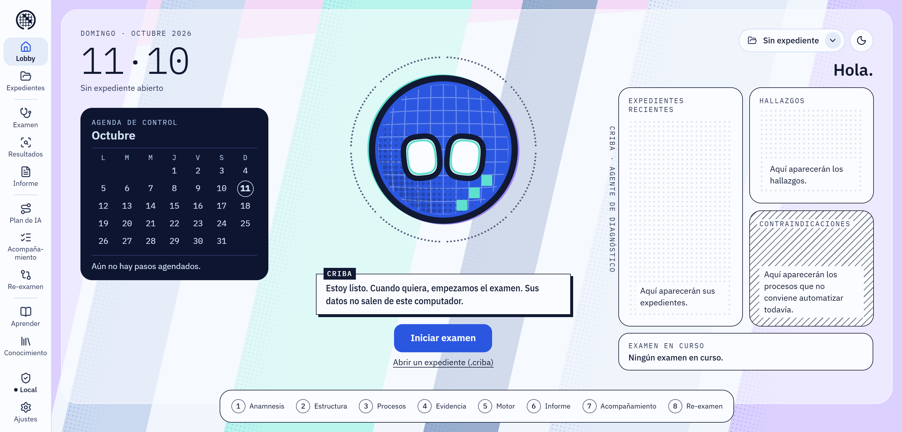
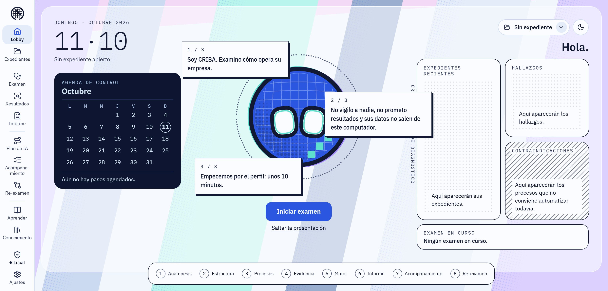
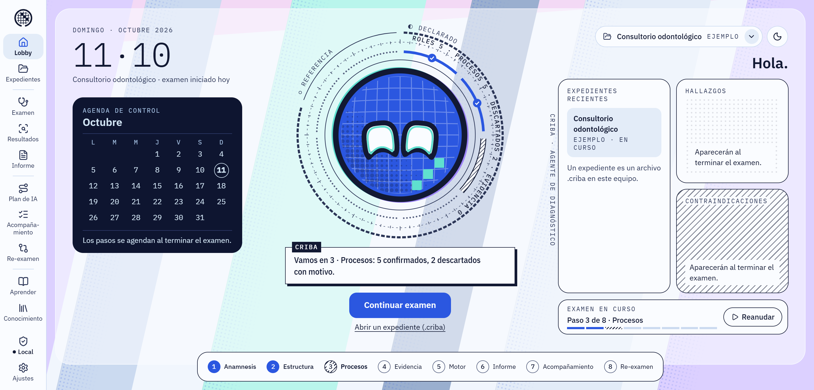
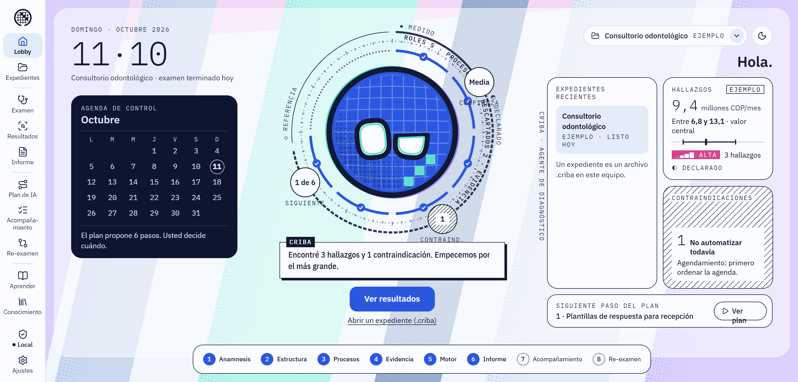
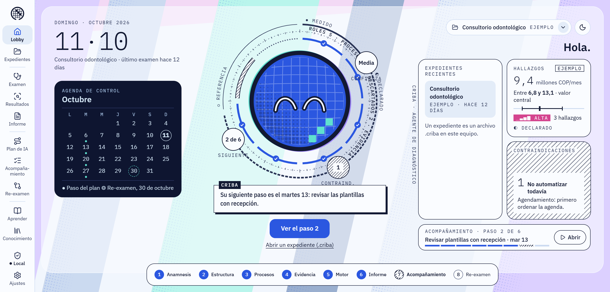

# CRIBA

**Un agente de diagnóstico que examina cómo opera una organización y le muestra,
con números en rango, dónde se le escapa el dinero y cómo la IA podría ayudar.**

Y, con el mismo peso, dónde **no** conviene automatizar todavía.

 

Diseño de la pantalla principal (mockup). El programa está en construcción.

> **In English.** CRIBA is a desktop diagnostic agent for small and mid-sized
> organizations that are afraid of AI, don't know where to start, or are out of date.
> It examines how the organization actually operates (roles, processes, demand) and
> reports where money is leaking, always as a range with visible assumptions, never as a
> promise. For each finding it builds an **AI plan**: what AI (or a simple rule, or just
> better order) could do, at what level of autonomy, which role owns it and the step by
> step to implement it, plus the cases where automating now would be a mistake. It runs
> entirely on the client's computer: nothing leaves the machine. Built with Java 25 and
> Spring Boot 4. Currently in development.

---

## El problema

Muchas empresas saben que "tienen que hacer algo con IA", pero no saben **dónde**, ni
**cuánto vale**, ni **por dónde empezar**. Los diagnósticos serios son caros y lentos;
los gratuitos son genéricos. Y el error más común es empezar por la herramienta en
lugar de por el proceso: automatizar el desorden solo lo acelera.

## Qué hace CRIBA

| | |
|---|---|
| **1 · Examina** | Reconoce cómo está armada la organización: sus roles (nunca personas), sus procesos y su volumen |
| **2 · Cuantifica** | Estima cuánto puede estar costando cada hueco, **en rango** y con sus supuestos a la vista, para que cualquiera pueda revisarlos |
| **3 · Dice "no"** | Señala dónde **no** conviene automatizar todavía, con el mismo peso que los hallazgos |
| **4 · Propone un plan de IA** | Por cada hallazgo: qué podría hacer la IA, con qué nivel de autonomía, qué rol lo lleva y el paso a paso, de lo más simple a lo más automático |
| **5 · Acompaña** | Lleva el plan en marcha, paso a paso, hasta el re-examen que compara el antes y el después |

## Las pantallas

El corazón es **el agente**: un tamiz con dos lentes por ojos que espera, escucha,
examina y avisa. Su estado refleja siempre el estado real del examen.

<table>
<tr>
<td width="50%"></td>
<td width="50%"></td>
</tr>
<tr>
<td><b>Primer arranque.</b> El agente se presenta y dice qué no hace: no vigila, no promete, no saca datos del equipo.</td>
<td><b>Examen en curso.</b> Cada anillo es un dato real: las fases del recorrido, los conteos y la procedencia de cada número.</td>
</tr>
<tr>
<td></td>
<td></td>
</tr>
<tr>
<td><b>Examen listo</b> (datos de EJEMPLO). La cifra siempre en rango, y las contraindicaciones al lado de los hallazgos.</td>
<td><b>Acompañamiento.</b> El siguiente paso del plan y la agenda hasta el re-examen.</td>
</tr>
</table>

Todas las capturas son del diseño aprobado; los datos son de un caso de ejemplo
inventado, nunca de un cliente.

## Principios

- **Nunca promete un resultado.** Estima en rango, con supuestos visibles y su nivel de confianza.
- **Cada número dice de dónde sale:** medido, declarado o valor de referencia con su fuente.
- **Reproducible:** el mismo expediente produce el mismo examen, siempre.
- **Local:** funciona en el computador del cliente, sin conexión; nada sale de la máquina.
- **Sin vigilancia:** no captura pantallas, no lee mensajes, no registra a nadie. Roles, no personas.
- **Neutral:** recomienda patrones, no marcas, y no vende herramientas.
- **La IA no calcula:** las cifras las produce un motor determinista; la IA es opcional y llega después.

## Stack

Java 25 · Spring Boot 4 · Thymeleaf + HTMX · SQLite (un archivo por expediente) ·
Flyway · ventana local de escritorio con servidor en `127.0.0.1` · instalador propio.

## Estado

En desarrollo. Diseño de la pantalla principal aprobado; construcción de las
fundaciones en curso. Se busca una primera versión para probar en organizaciones de
tres tipos: profesionales independientes, consultorios y empresas con muchos roles.

## Licencia

Software propietario. Este repositorio publica **solo** una presentación (texto e
imágenes); no contiene código fuente y su visibilidad no concede ningún derecho de uso.
Ver [LICENSE](LICENSE).

© 2026 Rubén Agudelo Alzate.
